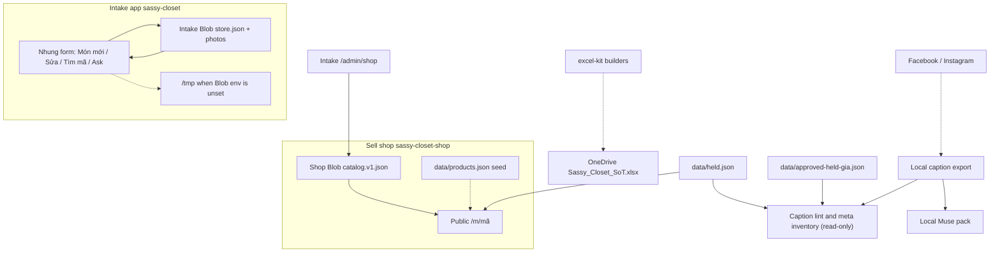

# Data flow

Edges below are ones the code or a repo doc names. A dashed edge is a fallback, or a step done outside this repo, not the normal read.

## What each edge means

| From | To | What moves | Source |
| --- | --- | --- | --- |
| Intake form | Intake Blob | Mã JSON and photo bytes, when Blob env is set | `sassy-closet/README.md`, `sassy-closet/lib/store-backend.ts` |
| Intake form | `/tmp` | Same data when Blob is not configured. A Production redeploy deletes it. | `sassy-closet/README.md` |
| Intake `/admin/shop` | Shop Blob `sassy-closet-shop/catalog.v1.json` | Titles, descriptions, color names, status, USD. Uses `SHOP_BLOB_READ_WRITE_TOKEN`, not the intake store token. | `sassy-closet/docs/SHOP_ADMIN.md` |
| Shop Blob | Product pages | Live catalog. Health `reading=blob` when this read works. | `sassy-closet-shop/lib/catalog-store.ts`, `docs/post-blob-unblock-checklist.md` |
| `products.json` | Product pages | Only after Blob, KV, and local reads miss or throw a non-corrupt error. A corrupt Blob does not take this path. | `sassy-closet-shop/lib/catalog-store.ts`, `lib/blob-catalog.ts` |
| `data/held.json` | Product pages | Those mãs are removed before the page lookup, so the page 404s. | `sassy-closet-shop/lib/held-incomplete.ts`, `lib/products.ts` |
| `data/held.json` and `approved-held-gia.json` | Caption lint | Held Giá must match the approved file. The tools do not post. | `scripts/caption_lint.py` |
| Saved caption export | Muse pack | Post id, platform, mã, counts, by way of `meta_caption_gap_report.py`. No caption text and no costs. | `scripts/muse_pack_sections.py` |
| Facebook / Instagram | Caption export | The export is an input file. No script in this repo downloads it. Who saves the export is UNKNOWN / not in repo. | `scripts/meta_inventory.py` header |
| Excel kit | OneDrive | README says Kit syncs generated workbooks after merge. The sync program is not a GitHub Action in `.github/workflows`. The live file is not in git. | `README.md` |
| Square | On-hand counts | Square Free is the stock source of truth. The kit builds a headers-only import CSV. Scripts do not tap Save. | `README.md`, `excel-kit/square/` |

Ask replies are a separate path: the browser posts `/api/ask`, the server may POST to `MINIBOSS_ASK_WEBHOOK_URL`, and a reply comes back through `/api/ask/reply` (`sassy-closet/README.md`). That path does not write the sell catalog.

`INTAKE_DATASET_SYNC_WEBHOOK_URL` is the immediate dataset sync after an intake save. The README says a poll backup already exists on Grok Bot. The bot's schedule is not in this repo.
